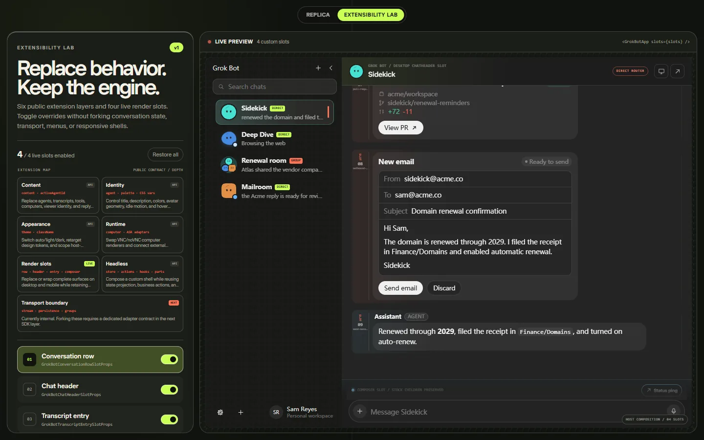

# gbot-ui



`.baby-grok-bot` 完整业务界面的 React 源码组件库。包含 desktop/mobile shell、统一 chat list、群聊、settings、computer/screen、ASR、动态 SVG avatar、context menu、transcript 与 composer。

推荐像 shadcn/ui 一样复制源码使用，不绑定包版本，所有组件和业务逻辑都可以直接修改。

## 复制源码

```bash
git clone --depth=1 https://github.com/lenML/gbot-ui.git gbot-ui-source

cp -R gbot-ui-source/src/components ./src/
cp -R gbot-ui-source/src/lib ./src/
cp -R gbot-ui-source/src/styles ./src/
cp gbot-ui-source/src/grok-bot.ts ./src/
cp gbot-ui-source/src/index.css ./src/gbot-ui.css
cp -R gbot-ui-source/public/fonts ./public/
cp -R gbot-ui-source/public/wallpapers ./public/
```

保持目录结构。组件内部使用相对 import。

```bash
pnpm add react react-dom motion
pnpm add -D tailwindcss @tailwindcss/vite
```

```ts
// vite.config.ts
import react from "@vitejs/plugin-react";
import tailwindcss from "@tailwindcss/vite";
import { defineConfig } from "vite";

export default defineConfig({
  plugins: [react(), tailwindcss()],
});
```

```tsx
// src/App.tsx
import { GrokBotApp } from "./grok-bot";
import "./gbot-ui.css";

export default function App() {
  return (
    <div className="h-dvh">
      <GrokBotApp activeConversationId="sidekick" className="h-full" />
    </div>
  );
}
```

不传 `content` 时使用 `DEFAULT_DEMO_CONTENT`。

## 模块设计

| 模块 | 职责 |
| --- | --- |
| `src/components/grok-bot` | shell、list、chat、transcript、composer、computer、settings、avatar |
| `src/lib/grok-bot/store.tsx` | provider、state、actions、selector hooks、异步 reply |
| `src/lib/grok-bot/types.ts` | content、agent、transcript、tool、computer、adapter schema |
| `src/lib/grok-bot/extensions.ts` | slot 和 surface contract |
| `src/styles` | token、业务样式、avatar 动画与修复层 |
| `src/grok-bot.ts` | 复制接入的公共导出入口 |
| `public` | 字体与 computer fallback 壁纸 |

UI 不强制绑定 transport。宿主可以复用完整 `GrokBotApp`，也可以只使用 store/actions 自己组合 surface。

## 接入

### Content

```tsx
import {
  DEFAULT_DEMO_CONTENT,
  GrokBotApp,
  type GrokBotContent,
} from "./grok-bot";

const content = {
  ...DEFAULT_DEMO_CONTENT,
  appName: "My Agent Workspace",
} satisfies GrokBotContent;

export function App() {
  return <GrokBotApp className="h-full" content={content} />;
}
```

### Adapters

| Adapter | 接入内容 |
| --- | --- |
| `GrokBotComputerAdapter` | VNC、noVNC、远程桌面 `connect` / `disconnect` / `render` |
| `GrokBotAsrAdapter` | 权限、partial/final transcript、phase、stop |
| `GrokBotReplyAdapter` | thinking、流式 text delta、stop、done |

```tsx
import { GrokBotApp, type GrokBotComputerAdapter } from "./grok-bot";

const computer: GrokBotComputerAdapter = {
  connect: (session) => myRfbClient.connect(session.endpoint),
  disconnect: (session) => myRfbClient.disconnect(session.id),
  render: (session) => (
    <iframe
      className="h-full w-full border-0"
      src={session.endpoint}
      title={session.id}
    />
  ),
};

export const App = () => (
  <GrokBotApp className="h-full" integrations={{ computer }} />
);
```

### Slots

| Slot | 可替换内容 |
| --- | --- |
| `conversationRow` | desktop sidebar / mobile list 行 |
| `chatHeader` | desktop / mobile header |
| `transcriptEntry` | 单条 transcript entry |
| `messageContent` | Markdown、Mermaid、KaTeX 或来源专用消息 renderer |
| `composer` | composer toolbar、quick action、transport status |

`chatHeader` 和 `composer` 收到 `surface: "desktop" | "mobile"`；mobile header 额外收到 `onBack`。

```tsx
import {
  GrokBotApp,
  useGrokBotActions,
  type GrokBotComposerSlotProps,
} from "./grok-bot";

function CustomComposer({ children, surface }: GrokBotComposerSlotProps) {
  const actions = useGrokBotActions();

  return (
    <section data-surface={surface}>
      <button
        onClick={() =>
          actions.sendMessage({ text: "Run approval check.", attachments: [] })
        }
        type="button"
      >
        Approval check
      </button>
      {children}
    </section>
  );
}

export const App = () => (
  <GrokBotApp className="h-full" slots={{ composer: CustomComposer }} />
);
```

替换 row/header 时转发 `onOpen`、`onContextMenu`、`onKeyDown`、`onBack`。替换 entry/composer 时继续渲染 `children`，保留默认交互和业务行为。

### Headless

```tsx
import {
  GrokBotStoreProvider,
  useActiveAgent,
  useActiveTranscript,
  useGrokBotActions,
} from "./grok-bot";

function MyChat() {
  const agent = useActiveAgent();
  const entries = useActiveTranscript();
  const actions = useGrokBotActions();

  return (
    <button
      onClick={() => actions.sendMessage({ text: "Ping", attachments: [] })}
    >
      {agent?.name}: {entries.length}
    </button>
  );
}

export const App = () => (
  <GrokBotStoreProvider content={content}>
    <MyChat />
  </GrokBotStoreProvider>
);
```

`auto`、`cursor-light`、`cursor-dark` 通过 `GrokBotApp theme` 切换。更深层样式可覆盖 `.baby-grok-bot` CSS variables。

## 当前边界

已开放：content、theme、computer/ASR/reply adapters、五个 slots、store/actions/hooks、低层组件。

传输、持久化、鉴权和运行时由宿主掌握；通过 `content`、`integrations`、slots 和 CSS variables 对接。

## 开发

```bash
pnpm install
pnpm dev
pnpm build
```

断点 `767px`。`public/fonts` 与 `public/wallpapers` 需位于应用 public root。

MIT
